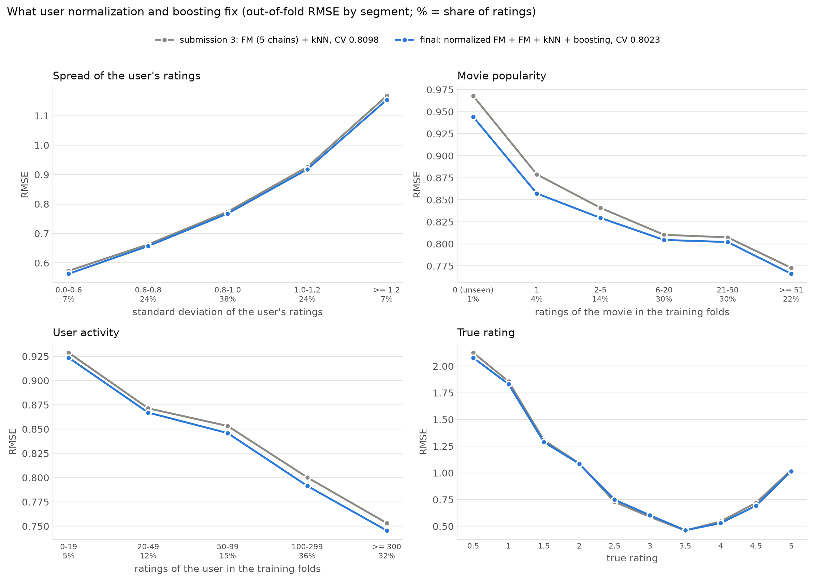

# collaborative-filtering — movie rating prediction with Bayesian factorization machines

**collaborative-filtering** completes a sparse users x movies rating matrix (610 x 4980, about 2 % of
the entries observed in the input) by stacking Bayesian factorization machines fitted by MCMC with an
item kNN. The submission ranked 3rd out of 30 teams in the class.



Out-of-fold RMSE by user and movie segment: final model (CV 0.8023) against submission 3 (CV 0.8098).

## Overview

- Problem: predict every missing rating (0.5 to 5 stars) of the course rating matrix; metric RMSE
  on hidden ratings, computed by the course evaluation platform, which fits `generate.py` on
  `ratings_train` + `ratings_test` (63,196 ratings) under a 20-minute limit.
- Approach: regularized biases, matrix factorization and kNN as baselines, then Bayesian models
  (BPMF, Bayesian factorization machines with implicit feedback and genres), per-user rating
  normalization, and a stack corrected by gradient boosting.
- Context: Data Science Lab, assignment 1 (collaborative filtering), Master IASD, PSL, October 2026.
  Team project, group 40.

## Results

5-fold cross-validation on the 63,196 ratings of `ratings_train` + `ratings_test`, every model on the
same folds (fold-to-fold standard deviation about 0.004). Rows follow the order in which the models
were built (report.pdf, Conclusion).

| Step | CV RMSE |
|---|---|
| Regularized biases (baseline) | 0.8642 |
| Best course method (item kNN) | 0.8523 |
| Posterior averaging (BPMF) | 0.8479 |
| Genres in a Bayesian FM | 0.8190 |
| Implicit feedback | 0.8171 |
| Five chains | 0.8117 |
| User normalization | 0.8049 |
| Stack with item kNN and gradient boosting (final) | **0.8023** |

Platform scores (hidden ratings): 0.812 for a single-chain Bayesian FM (rank 5), 0.801 for the
5-chain Bayesian FM stacked with the item kNN. The full analysis (paired tests, error analysis by
user and movie segment) is in [`report.pdf`](report.pdf).

## Installation

```bash
python -m venv .venv && source .venv/bin/activate     # Python 3.12
pip install -r requirements.txt
pip install torch                                     # only for the experiment scripts
```

## Quick start

Place the course files in `data/` (see [Data](#data)), then fit on train and score on test:

```bash
python generate.py --name data/ratings_train.npy
python experiments/evaluate_output.py --output output.npy --test data/ratings_test.npy
```

`generate.py` writes `output.npy`, the completed 610 x 4980 matrix (about 5.5 min on train + test,
CPU). Without `data/stack_train.npz` (out-of-fold predictions, not versioned because they contain the
ratings), the gradient-boosting correction is skipped and a fixed linear stack is used; this path
scores 0.8282 RMSE on `ratings_test` when fitted on `ratings_train`.

## Repository structure

- `generate.py`: platform entry point, completes a ratings matrix with the final model.
- `src/final_stack.py`: final model, user-normalized and raw Bayesian FMs, item kNN, stack + boosting.
- `src/bfm.py`: Bayesian factorization machines (package `myfm`) with implicit feedback and side features.
- `src/bpmf.py`: Bayesian probabilistic matrix factorization with biases, by Gibbs sampling.
- `src/baselines.py`, `src/mf.py`, `src/knn.py`, `src/knn_course.py`: biases, matrix factorization
  (ALS, SGD), neighbourhood models. Every model exposes `fit_xxx(train, shape, **hp) -> predict(u, i)`.
- `src/`: other models tried (AutoRec, GC-MC, GLocal-K, EASE, Soft-Impute, ensembles).
- `experiments/`: one script per experiment, writing `results/*.csv` and `figures/`.
- `slides/`: preliminary presentation (`slides.tex`, course methods) and the deck of every method tested.
- `report.pdf`: final report.

The branch `va/preliminary` holds the unified cross-validation, the error analysis and the report
source (`report/report_2col.tex`).

## Method

1. **Bayesian factorization machine** ([myFM](https://github.com/tohtsky/myFM)): user and movie
   one-hots, implicit feedback (movies rated by the user, users who rated the movie, weighted
   |N|^-1/2), genres and release decade; rank 20, 238 Gibbs iterations (20 burn-in), posterior means
   of 5 chains averaged.
2. **User normalization**: one FM is fitted on z = (r - m_u) / s_u, with the user mean and standard
   deviation shrunk towards the global ones (20 pseudo-ratings), and mapped back; a second FM is
   fitted on raw ratings.
3. **Item kNN** on bias residuals (Pearson similarity shrunk with 100 pseudo-users, k = 20).
4. **Stack**: least-squares combination of the three predictions, corrected by gradient-boosted
   trees (scikit-learn, 200 trees) on its residual, with the chain disagreement and user / movie
   statistics as features; both learnt on out-of-fold predictions.

Hyperparameters are chosen by cross-validation on train + test: settings tuned on train alone favour
smaller models (rank 5 and 20 tie on train, rank 20 wins on the union).

## Data

The ratings are distributed with the course and are not included here.
Expected layout:

```
data/
├── ratings_train.npy   # 610 x 4980, NaN = missing, 31,598 ratings
├── ratings_test.npy    # same shape, 31,598 other ratings
└── namesngenre2.npy    # title and genres of each movie column
```

## References

1. R. Salakhutdinov, A. Mnih. Bayesian probabilistic matrix factorization using Markov chain Monte Carlo. ICML 2008.
2. S. Rendle. Factorization machines. ICDM 2010.
3. C. Freudenthaler, L. Schmidt-Thieme, S. Rendle. Bayesian factorization machines. NIPS Workshop, 2011.
4. S. Rendle, L. Zhang, Y. Koren. On the difficulty of evaluating baselines. arXiv:1905.01395, 2019.
5. Y. Koren. Factorization meets the neighborhood. KDD 2008.

## Team

Quentin Revillon and Vincent Ami (group 40). Course by Alexandre Vérine, Université Paris Dauphine - PSL.
