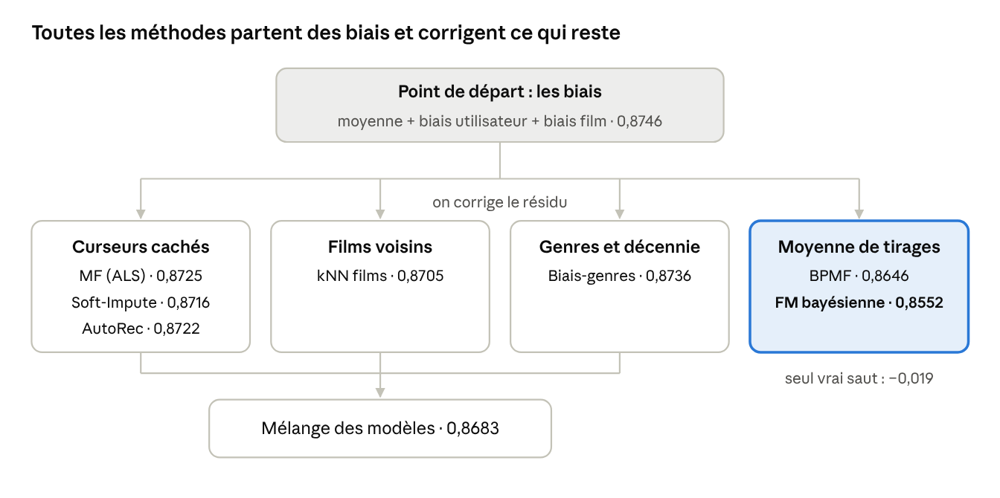

# Cours : les méthodes de recommandation du projet

Toutes nos méthodes cherchent à deviner les notes manquantes d'un tableau utilisateurs × films.
La meilleure, la FM bayésienne, fait une erreur moyenne de 0,855 étoile, contre 0,875 pour la méthode la plus simple.

Sommaire :

1. [Le problème](#1-le-problème)
2. [Vue d'ensemble](#2-vue-densemble)
3. [Trois idées à comprendre avant les méthodes](#3-trois-idées-à-comprendre-avant-les-méthodes)
4. [Méthode 1 — La moyenne, puis les biais](#4-méthode-1--la-moyenne-puis-les-biais)
5. [Méthode 2 — La factorisation de matrice](#5-méthode-2--la-factorisation-de-matrice-mf)
6. [Méthode 3 — Soft-Impute](#6-méthode-3--soft-impute)
7. [Méthode 4 — Les plus proches voisins](#7-méthode-4--les-plus-proches-voisins-knn-sur-films)
8. [Méthode 5 — Les biais guidés par les genres](#8-méthode-5--les-biais-guidés-par-les-genres)
9. [Méthode 6 — Le mélange de modèles](#9-méthode-6--le-mélange-de-modèles)
10. [Méthode 7 — AutoRec (deep learning)](#10-méthode-7--autorec-deep-learning)
11. [Méthode 8 — Les méthodes bayésiennes](#11-méthode-8--les-méthodes-bayésiennes-bpmf-et-fm-bayésienne)
12. [Comparatif](#12-comparatif--ce-qui-distingue-chaque-méthode)
13. [Lire les formules des slides](#13-lire-les-formules-des-slides)
14. [Glossaire](#14-glossaire)

---

## 1. Le problème

On a un grand tableau : une ligne par utilisateur (610), une colonne par film (4 980).
Chaque case contient la note, de 0,5 à 5 étoiles, que l'utilisateur a donnée au film.
Mais 99 % des cases sont vides : les gens n'ont vu qu'une petite partie des films.

Notre travail : **deviner les notes des cases vides**. C'est ce qu'on appelle le *filtrage collaboratif* :
on s'aide des notes des autres pour deviner les vôtres.

|       | Titanic | Alien | Toy Story | Matrix |
| ----- | ------- | ----- | --------- | ------ |
| Alice | 4       | ?     | 5         | ?      |
| Bob   | ?       | 5     | ?         | 4,5    |
| Chloé | 3       | 4     | ?         | ?      |

**Comment on juge une prédiction ?** On cache des notes connues, on les prédit, et on mesure l'écart.
La mesure s'appelle la **RMSE** : en gros, l'erreur moyenne en nombre d'étoiles (elle punit plus fort les grosses erreurs).
Une RMSE de 0,87 veut dire qu'on se trompe d'environ 0,87 étoile en moyenne. **Plus c'est bas, mieux c'est.**

La plateforme du cours mesure aussi l'*accuracy* (pourcentage de notes devinées exactement, à la demi-étoile près)
et le temps de calcul (limite : 20 minutes sur 4 cœurs, sans carte graphique).

## 2. Vue d'ensemble



On part toujours des biais, puis chaque famille ajoute sa propre correction : des curseurs cachés, des films voisins ou des genres.
L'approche bayésienne, encadrée, fait la moyenne de milliers de solutions au lieu d'en choisir une.
Les nombres sont les erreurs (RMSE) sur le test : plus c'est bas, mieux c'est.

## 3. Trois idées à comprendre avant les méthodes

### Idée 1 : entraînement, validation, test

C'est comme réviser un examen : on ne doit pas connaître les questions à l'avance, sinon la note ne veut plus rien dire.

1. **Entraînement (train, 90 %)** : les notes que le modèle voit pour apprendre. C'est le cours.
2. **Validation (10 % du train)** : des notes mises de côté pour choisir les réglages. C'est l'examen blanc.
3. **Test** : des notes jamais utilisées avant la toute fin, regardées **une seule fois**. C'est le vrai examen.

Une fois les réglages choisis, on réentraîne sur tout le train, puis on mesure sur le test.
Sur la plateforme, c'est pareil avec un échelon de plus : notre code reçoit train + test, et il est noté sur des notes cachées.

### Idée 2 : le surapprentissage

Un modèle trop libre apprend les notes du train *par cœur*, bruit compris.
Il est parfait sur le train et mauvais sur des notes nouvelles : c'est l'élève qui récite le corrigé sans avoir compris.

Le signe qui ne trompe pas : l'erreur sur le train baisse, mais l'erreur sur la validation remonte.
Chez nous, la factorisation sans précaution a une erreur de presque 0 sur le train… et plus de 1,0 en validation,
pire que la méthode la plus simple.

Ici le risque est énorme : un film a **3 notes** en médiane. Avec 3 notes, on ne peut pas apprendre grand-chose de fiable sur ce film.

### Idée 3 : la régularisation

La régularisation est le remède au surapprentissage. On ajoute une **pénalité** qui dit au modèle :
« reste prudent, ne t'éloigne de la valeur par défaut que si les données le justifient vraiment ».

La force de cette pénalité est un bouton qu'on règle, noté **λ** (lambda) :

- λ trop petit : le modèle croit tout, il surapprend ;
- λ trop grand : le modèle ne croit rien, il répond toujours la valeur par défaut ;
- le bon λ : on le trouve en essayant plusieurs valeurs et en gardant la meilleure en validation.

Ces boutons qu'on règle à la main s'appellent des **hyperparamètres** (λ, le rang, le nombre de voisins…).
Les nombres que le modèle apprend tout seul s'appellent des **paramètres**.

## 4. Méthode 1 — La moyenne, puis les biais

Les biais seuls font déjà 90 % du travail : l'erreur passe de 1,037 (moyenne) à 0,875.
C'est notre **baseline**, la référence à battre.

### Étape 0 : la moyenne

La prédiction la plus bête : répondre partout la note moyenne de tout le tableau, environ 3,5. Erreur : **1,037**.

### Étape 1 : ajouter les biais

Un *biais*, c'est une tendance systématique. Il y en a deux :

- **le biais de l'utilisateur** : Bob est sévère, il note en moyenne 0,5 en dessous des autres (biais = −0,5) ;
- **le biais du film** : Le Parrain est adulé, il reçoit en moyenne 0,8 au-dessus (biais = +0,8).

La prédiction devient une simple addition :

> note prédite = moyenne + biais de l'utilisateur + biais du film
>
> Bob × Le Parrain = 3,5 − 0,5 + 0,8 = **3,8**

### Où intervient la régularisation

Un film vu une seule fois, et noté 5 : son biais serait de +1,5. C'est sûrement exagéré, une seule personne ne suffit pas.
La régularisation tire le biais vers 0 quand le film a peu de notes :

- 1 note → le biais est fortement réduit (on reste prudent) ;
- 200 notes → le biais est presque intact (on fait confiance aux données).

Concrètement, le biais d'un film = la somme de ses écarts à la moyenne, divisée par (nombre de notes + λ).
Avec λ = 2, un film à 1 note voit son écart divisé par 3 ; un film à 200 notes, par 202 au lieu de 200 : quasi rien.

### Comment on l'apprend

On calcule les biais des films en supposant ceux des utilisateurs connus, puis l'inverse, et on recommence une vingtaine de fois.
Chaque calcul est une simple moyenne : c'est instantané (0,01 seconde).

**Résultat :** RMSE **0,875** avec λ = 2. C'est ce que fait actuellement notre `generate.py`.

**Ce qu'il faut retenir :** toutes les méthodes suivantes partent des biais et essaient de prédire **ce qui reste** :
l'écart entre la vraie note et la prédiction des biais. On appelle cet écart le **résidu**.
Le résidu, c'est le goût personnel : « Alice aime la science-fiction plus que la moyenne des gens ».

## 5. Méthode 2 — La factorisation de matrice (MF)

La factorisation décrit chaque utilisateur et chaque film par quelques nombres cachés, puis compare ces descriptions.
Gain chez nous : faible (0,8725 contre 0,875), et seulement si la régularisation est bien réglée.

### L'intuition

Imaginons qu'on décrive chaque film par 2 curseurs, « action » et « romance »,
et chaque utilisateur par 2 curseurs, « aime l'action » et « aime la romance ».

|                      | action | romance |
| -------------------- | ------ | ------- |
| Film : Alien         | 0,9    | 0,1     |
| Utilisatrice : Alice | 0,8    | −0,5    |

Pour prédire si Alice aimera Alien, on multiplie curseur par curseur et on additionne :
0,9 × 0,8 + 0,1 × (−0,5) = **+0,67**. Les goûts d'Alice collent au film : bonus de 0,67 étoile, ajouté aux biais.

> note prédite = moyenne + biais utilisateur + biais film + (accord entre les curseurs)

La magie : **on ne choisit pas les curseurs**. Le modèle les invente tout seul à partir des notes.
Ils sont « cachés » (on dit *facteurs latents*) et souvent impossibles à nommer.
Le nombre de curseurs s'appelle le **rang** (nous : 10 à 20).

Pourquoi « factorisation » : le grand tableau 610 × 4 980 est approché par le produit de deux petits tableaux,
610 × rang (les utilisateurs) et rang × 4 980 (les films). Comme 12 = 3 × 4.

### Comment on trouve les curseurs : deux méthodes

On cherche les curseurs qui reproduisent au mieux les notes connues, avec une pénalité pour ne pas surapprendre.

**ALS (moindres carrés alternés).** Le problème est dur parce qu'on cherche les deux tableaux à la fois.
Mais si on fige les films, trouver les utilisateurs devient facile : c'est une régression linéaire,
qui se résout d'un coup par une formule. Donc on alterne :

1. on fige les films, on calcule les meilleurs utilisateurs ;
2. on fige les utilisateurs, on calcule les meilleurs films ;
3. on recommence (15 fois suffisent).

**SGD (descente de gradient stochastique).** On prend les notes une par une. Pour chacune, on regarde l'erreur,
et on pousse un tout petit peu les curseurs de l'utilisateur et du film dans la direction qui réduit cette erreur.
On fait plusieurs passages sur toutes les notes.

|                  | ALS                              | SGD                                              |
| ---------------- | -------------------------------- | ------------------------------------------------ |
| Principe         | alterner deux problèmes faciles  | petits pas, note par note                        |
| Réglages         | λ, rang                          | λ, rang, **taille du pas**, nombre de passages   |
| Stabilité        | très stable                      | sensible à la taille du pas                      |
| Notre RMSE test  | **0,8725**                       | 0,8775 (pire que les biais)                      |

**ALS-WR** est une variante d'ALS : la pénalité d'un utilisateur grandit avec son nombre de notes.
Chez nous, elle ne fait pas mieux (0,8746).

### Ce qu'on a appris

Tout se joue sur λ, la force de la pénalité sur les curseurs :

- sans pénalité, surapprentissage massif : erreur proche de 0 sur le train, plus de 1,0 en validation ;
- pénalité de 15 ou plus : les curseurs sont écrasés à 0 et on retombe exactement sur les biais ;
- la bonne zone est étroite, autour de 10. Une fois λ bien choisi, le rang compte peu.

Pourquoi le gain est si faible : avec 3 notes par film en médiane, il n'y a pas assez d'information
pour placer les curseurs de la plupart des films.

## 6. Méthode 3 — Soft-Impute

Soft-Impute vise le même but que la factorisation, mais sans fixer le nombre de curseurs à l'avance :
il en garde automatiquement juste ce qu'il faut. RMSE test : **0,8716**, en 4,7 secondes.

### L'idée : remplir, simplifier, recommencer

On travaille sur les résidus (notes moins biais) et on répète une boucle :

1. **Remplir** : on met dans les cases vides notre meilleure devinette du moment (0 au départ) ; les cases connues gardent leur vraie valeur.
2. **Simplifier** : on « lisse » ce tableau complet pour n'en garder que les grandes tendances.
3. On recommence avec ce tableau lisse comme nouvelle devinette, jusqu'à ce que ça ne bouge plus.

### Comment on « simplifie »

Tout tableau peut se décomposer en une somme de « motifs », du plus important au plus faible.
C'est la **SVD** (décomposition en valeurs singulières). Chaque motif a une force, appelée *valeur singulière*.
On peut le voir comme un son décomposé en notes de musique, des plus fortes aux plus faibles.

Soft-Impute retire la même quantité **τ** (tau) à la force de chaque motif :

- un motif fort (force 50) devient 40 : il reste ;
- un motif faible (force 6) tombe à 0 : il disparaît.

Les motifs faibles sont surtout du bruit : on les supprime. C'est ce qui donne le nom *soft* : on rabote tout, on ne coupe pas net.
τ joue le rôle de λ : c'est le bouton de régularisation. Notre meilleur réglage : τ = 10.

### Différence avec la factorisation

|                     | Factorisation (ALS)         | Soft-Impute                     |
| ------------------- | --------------------------- | ------------------------------- |
| Nombre de curseurs  | fixé à l'avance (le rang)   | choisi automatiquement par τ    |
| Ce qu'on manipule   | deux petits tableaux        | le grand tableau complet        |
| Réglages            | rang + λ                    | τ seulement                     |
| RMSE test           | 0,8725                      | 0,8716                          |

Constat : avec τ = 20 ou plus, tous les motifs disparaissent et on retombe sur les biais.
Le signal au-delà des biais existe, mais il est mince.

## 7. Méthode 4 — Les plus proches voisins (kNN sur films)

Le kNN prédit la note d'un film à partir des films ressemblants que l'utilisateur a déjà notés.
RMSE test : **0,8705**, la meilleure des méthodes « simples ».

### L'intuition

« Vous avez adoré Alien et Terminator, vous aimerez sûrement Predator. »
Aucun curseur caché ici : on compare directement les films entre eux.

### Pas à pas, pour prédire la note d'Alice sur Predator

1. **Mesurer la ressemblance entre films.** Deux films se ressemblent si les gens qui ont vu les deux réagissent pareil :
   ceux qui aiment l'un plus que prévu aiment aussi l'autre plus que prévu.
   On mesure ça sur les résidus avec une corrélation, un nombre entre −1 et 1.
2. **Se méfier des petits échantillons.** Si deux films n'ont que 2 spectateurs en commun, leur ressemblance n'est pas fiable.
   On la réduit d'autant plus qu'il y a peu de spectateurs communs (réglage *shrink* = 100).
3. **Choisir les voisins.** Parmi les films qu'Alice a notés, on garde les k = 40 plus ressemblants à Predator.
4. **Faire la moyenne.** On regarde comment Alice a noté ces voisins par rapport à ce que prévoyaient les biais.
   On fait la moyenne de ces écarts, pondérée par la ressemblance, et on l'ajoute aux biais.

> note prédite = biais + moyenne pondérée des écarts d'Alice sur les films voisins

### Notre petite correction : β

La formule du cours a un défaut ici : si Alice n'a qu'un voisin, très peu ressemblant, la formule recopie quand même tout son écart.
Avec 1 % de notes connues, ce cas est fréquent.

On ajoute donc un petit nombre **β = 0,2** au dénominateur de la moyenne. Quand les voisins sont nombreux et ressemblants,
ça ne change presque rien. Quand ils sont rares ou peu ressemblants, la correction est réduite et on reste proche des biais.
C'est encore de la régularisation. Effet mesuré en validation : 0,908 sans β, **0,885** avec.

### Où il aide

Le kNN brille sur les films populaires (50 notes et plus) : erreur réduite de 0,016 par rapport aux biais.
Sur les films à 1 ou 2 notes, il fait légèrement pire : pas assez de spectateurs pour trouver des voisins fiables.

## 8. Méthode 5 — Les biais guidés par les genres

Cette méthode utilise une information en plus des notes : le genre et l'année de chaque film.
Gain global minuscule (0,8736 contre 0,8746), mais c'est la seule qui aide sur les films presque jamais notés.

### Le problème qu'elle règle

Dans les biais classiques, un film sans notes a un biais de 0 : on lui prédit la moyenne.
Or on sait des choses sur lui : un documentaire des années 1950 n'est pas noté comme une comédie d'horreur récente.

### L'idée

Au lieu de tirer le biais d'un film vers 0, on le tire vers **ce que prédisent son genre, sa décennie et sa popularité**.

1. On apprend combien chaque genre et chaque décennie rapporte en moyenne
   (exemple fictif : « Film-Noir » +0,3, « Horror » −0,4). C'est une régression linéaire.
2. Pour chaque film, cette estimation sert de point de départ au biais.
3. Si le film a beaucoup de notes, ses notes l'éloignent de ce point de départ. S'il en a très peu, il y reste.

La popularité (le nombre de notes du film) aide aussi : les films rarement notés sont en moyenne moins bien notés.

**Où elle aide :** sur les films à 1 ou 2 notes, c'est la seule méthode qui bat les biais (0,940 contre 0,944).
Ces informations servent à nouveau, plus efficacement, dans la FM bayésienne (section 11).

## 9. Méthode 6 — Le mélange de modèles

Le mélange combine les prédictions de plusieurs modèles et fait mieux que chacun d'eux :
RMSE test **0,8683**, contre 0,8705 pour le meilleur modèle seul.

### L'intuition

C'est la sagesse des foules : si plusieurs experts se trompent **à des endroits différents**, leur avis combiné est plus juste.
Le kNN est fort sur les films populaires, les biais-genres sur les films rares : en les combinant, on profite des deux.

### Pas à pas

1. On entraîne les 5 modèles (biais, biais-genres, Soft-Impute, kNN, ALS) sur 90 % du train.
2. Chacun prédit les 10 % de validation.
3. On apprend la meilleure combinaison : note prédite = a × (prédiction 1) + b × (prédiction 2) + … + constante.
   Les poids a, b… minimisent l'erreur en validation (régression *ridge* : régression linéaire avec un peu de régularisation).
4. On réentraîne les 5 modèles sur tout le train et on leur applique ces poids.

**Pourquoi la validation et pas le train ?** Sur le train, les modèles qui surapprennent ont l'air excellents :
le mélange leur donnerait trop de poids.

### Les poids appris

| Modèle       | Poids |
| ------------ | ----- |
| kNN          | 0,94  |
| Biais-genres | 0,72  |
| ALS          | 0,29  |
| Soft-Impute  | 0,06  |
| Biais        | −1,01 |

Le poids négatif des biais n'est pas absurde : tous les modèles contiennent déjà les biais.
On les retire une fois pour ne pas les compter plusieurs fois. Le mélange garde donc surtout **les corrections** de chaque modèle.

## 10. Méthode 7 — AutoRec (deep learning)

AutoRec est un petit réseau de neurones. Sur nos données, il ne fait pas mieux que les méthodes simples :
**0,8722**, et il n'améliore pas le mélange (0,8682 contre 0,8683).

### L'intuition : compresser puis décompresser

Un *auto-encodeur* est un réseau qui apprend à recopier son entrée en passant par un goulot d'étranglement :

1. **Entrée** : la colonne d'un film, c'est-à-dire les notes des 610 utilisateurs (trouée : la plupart sont inconnues).
2. **Compression** : le réseau la résume en 500 nombres (la *couche cachée*).
3. **Décompression** : il reconstruit à partir de ce résumé les 610 notes, **y compris celles qui manquaient**.

On l'entraîne à bien reconstruire les notes connues ; les notes inconnues sortent « gratuitement » à la reconstruction.
Les 500 nombres du résumé jouent le rôle des curseurs de la factorisation, mais le réseau peut apprendre
des relations non linéaires (plus complexes qu'une multiplication-addition).

### Ce qu'on a testé

| Variante                                   | RMSE test                  |
| ------------------------------------------ | -------------------------- |
| Par film, sur les notes brutes             | 0,912 (pire que les biais) |
| Par utilisateur, sur les résidus           | 0,883                      |
| **Par film, sur les résidus**              | **0,8722**                 |
| Par film, résidus, version « Sparse FC »   | 0,873                      |

Le déclic : le réseau marche beaucoup mieux sur les résidus que sur les notes brutes.
Les biais font le gros du travail, le réseau n'a plus qu'à apprendre les goûts.

### Pourquoi le deep learning échoue ici

Le réseau a des centaines de milliers de paramètres pour seulement 31 600 notes.
Il surapprend très vite, même avec une forte régularisation et en arrêtant l'entraînement au bon moment.
C'est cohérent avec la littérature : sur des données aussi creuses, les méthodes bayésiennes battent le deep learning.

## 11. Méthode 8 — Les méthodes bayésiennes (BPMF et FM bayésienne)

C'est notre meilleur résultat, et le seul vrai saut : la FM bayésienne atteint **0,8552**,
soit 0,019 de mieux que les biais, en 60 secondes.

### L'idée : faire la moyenne au lieu de choisir

Toutes les méthodes précédentes cherchent **les** meilleurs curseurs, une seule solution.
Avec si peu de notes, beaucoup de solutions différentes expliquent les données presque aussi bien. En choisir une, c'est parier.

L'approche bayésienne ne parie pas : elle tire au sort des milliers de solutions plausibles
et fait **la moyenne de leurs prédictions**. C'est encore la sagesse des foules, mais à l'intérieur d'un seul modèle.

### Comment on tire ces solutions (l'échantillonnage de Gibbs)

C'est la même alternance que l'ALS, avec du hasard :

1. on fige les films, on **tire au sort** des curseurs utilisateurs plausibles (au lieu de prendre les meilleurs) ;
2. on fige les utilisateurs, on tire des curseurs films plausibles ;
3. on tire aussi la force de la régularisation ;
4. on note la prédiction obtenue, et on recommence des centaines de fois.

La prédiction finale est la moyenne de toutes ces prédictions. Les premiers tirages, encore mauvais, sont jetés (*burn-in*).

**Fait frappant :** une solution tirée seule est mauvaise (erreur ≈ 1,03, pire que la moyenne globale).
La moyenne de 2 000 tirages : 0,873 en validation. Tout le gain vient de la moyenne.

**Bonus : plus de λ à régler.** La force de la régularisation est elle-même tirée au sort et apprise des données.

### BPMF : la factorisation bayésienne

C'est exactement la factorisation de la section 5 (biais + curseurs), en version bayésienne.
Résultat : **0,8646** (rang 20, 300 tirages, 44 s).

### FM bayésienne : on ajoute des informations

Une *machine de factorisation* (FM) est une factorisation généralisée : elle peut recevoir d'autres informations
que « qui » et « quel film », chacune avec ses propres curseurs. Nous lui en donnons trois :

- **les films notés par l'utilisateur** : le simple fait d'avoir vu tel film dit quelque chose sur vos goûts, quelle que soit la note (idée de *SVD++*) ;
- **les utilisateurs qui ont noté le film** : la même idée côté film, le public d'un film décrit le film ;
- **les genres et la décennie** du film.

Nous utilisons la bibliothèque `myfm`, qui fait l'échantillonnage de Gibbs pour nous.

### Quelle information compte le plus ? (test d'ablation)

On ajoute chaque information seule pour mesurer son apport (RMSE de validation, plus bas = mieux) :

| Configuration                              | RMSE validation |
| ------------------------------------------ | --------------- |
| FM de base (= MF bayésienne)               | 0,8887          |
| + films notés par l'utilisateur            | 0,8850          |
| + genres et décennie                       | 0,8840          |
| + **utilisateurs qui ont noté le film**    | **0,8762**      |
| Les trois ensemble                         | **0,8728**      |

Le plus utile, de loin : savoir **qui a regardé le film**, plus que les notes elles-mêmes.
Pour un film à 3 notes, ces 3 spectateurs disent beaucoup sur le type de film.

**Temps :** 93 s sur les données de la plateforme (train + test), loin de la limite de 1 200 s.

## 12. Comparatif : ce qui distingue chaque méthode

Les méthodes « à solution unique » restent toutes à moins de 0,01 des biais ;
seule l'approche bayésienne, qui fait la moyenne et sait qui a vu quel film, fait un saut net.
Tableau trié du meilleur au moins bon (RMSE sur le test, entraînement sur le train).

| Méthode              | Idée en une phrase                                          | Bouton de régularisation | RMSE test  | Temps  |
| -------------------- | ----------------------------------------------------------- | ------------------------ | ---------- | ------ |
| **FM bayésienne**    | moyenne de milliers de factorisations, + qui a vu quoi + genres | appris tout seul     | **0,8552** | 60 s   |
| BPMF                 | moyenne de milliers de factorisations                       | appris tout seul         | 0,8646     | 44 s   |
| Mélange              | combinaison pondérée de 5 modèles                           | ridge (α)                | 0,8683     | 7,7 s  |
| kNN films            | écarts sur les films ressemblants déjà notés                | shrink, β, k             | 0,8705     | 1,1 s  |
| Soft-Impute          | remplir, lisser par SVD, recommencer                        | τ                        | 0,8716     | 4,7 s  |
| AutoRec              | réseau qui compresse puis reconstruit                       | λ + arrêt anticipé       | 0,8722     | 17 s   |
| MF — ALS             | curseurs cachés, calcul alterné                             | λ facteurs, λ biais      | 0,8725     | 1,5 s  |
| Biais + genres       | biais tiré vers ce que prédit le genre                      | λ, λ genres              | 0,8736     | 0,04 s |
| **Biais (baseline)** | moyenne + sévérité + popularité                             | λ                        | **0,8746** | 0,01 s |
| MF — ALS-WR          | ALS, pénalité × nombre de notes                             | λ                        | 0,8746     | 1,5 s  |
| MF — SGD             | curseurs cachés, petits pas                                 | λ + taille du pas        | 0,8775     | 0,5 s  |
| Moyenne globale      | la même note partout                                        | aucun                    | 1,0369     | 0 s    |

### Les grandes différences, en trois oppositions

- **Curseurs cachés ou comparaison directe.** Factorisation, Soft-Impute, AutoRec et bayésien inventent des curseurs cachés ;
  le kNN compare directement les films entre eux.
- **Une solution ou une moyenne.** Toutes les méthodes choisissent une solution, sauf BPMF et FM bayésienne qui en moyennent des milliers.
  C'est ce qui fait la différence ici.
- **Notes seules ou informations en plus.** Biais-genres et FM bayésienne utilisent aussi les genres et l'année ;
  la FM utilise en plus « qui a vu quoi ».

### Les leçons du projet

1. Avec 1 % de notes connues, les biais font 90 % du gain.
2. Pour les méthodes à solution unique, le réglage de la régularisation compte plus que le choix du modèle.
3. Arrondir les prédictions à la demi-étoile ne change pas l'accuracy mais dégrade la RMSE de 0,012 : on n'arrondit pas.
4. Sur des données aussi creuses, bayésien > deep learning.

## 13. Lire les formules des slides

Cette section traduit en français chaque symbole des slides, slide par slide. Aucun prérequis.

### Les briques communes

| Symbole | Se lit | Sens |
| ------- | ------ | ---- |
| u, i | « u », « i » | un utilisateur (*user*) et un film (*item*) quelconques |
| r_ui | « r u i » | la vraie note (*rating*) de l'utilisateur u sur le film i |
| r̂_ui | « r chapeau u i » | la note **prédite** ; le chapeau ^ signale toujours une estimation |
| μ | « mu » | la moyenne globale des notes (≈ 3,5) |
| Σ | « somme » | additionner ; l'écriture sous le Σ dit sur quoi on additionne |
| (u,i) ∈ T | « u i appartient à T » | « pour chaque note (u, i) de l'ensemble T » |
| \|T\| | « cardinal de T » | le nombre d'éléments de T |
| λ, τ, β | lambda, tau, bêta | des boutons de réglage (hyperparamètres) |
| ℝ | « R » | l'ensemble des nombres réels (des nombres à virgule) |

Exemple de lecture : « Σ sur (u,i) ∈ T de r_ui » = additionner toutes les vraies notes de l'ensemble T.

**Vecteur.** Une liste de nombres, par exemple les curseurs d'Alice : p = (0,8 ; −0,5).
**Matrice.** Un tableau de nombres, comme notre tableau 610 × 4 980.

### Slide « Le problème » : la RMSE

```math
\mathrm{RMSE} = \sqrt{\tfrac{1}{|T|} \sum_{(u,i)\in T} (r_{ui} - \hat r_{ui})^2}
```

On lit de l'intérieur vers l'extérieur :

1. r_ui − r̂_ui : l'erreur sur une note (vraie moins prédite) ;
2. au carré : on rend l'erreur positive et on punit davantage les grosses erreurs (2² = 4, mais 0,5² = 0,25) ;
3. Σ puis 1/|T| : on fait la moyenne sur les |T| notes de test ;
4. √ : la racine ramène le résultat en étoiles.

Exemple avec 2 notes : erreurs 1 et 0 → carrés 1 et 0 → moyenne 0,5 → racine ≈ 0,71 étoile.

### Slide « Les données »

- **Longue traîne** (figure de gauche) : peu de films ont beaucoup de notes, et une foule de films en ont très peu.
  La courbe ressemble à une queue qui s'étire vers la droite.
- **Spectre** (figure de droite) : les forces des motifs de la SVD (section 6), rangées de la plus forte à la plus faible.
- **Bruit permuté** : on mélange les résidus au hasard pour détruire toute structure, et on recalcule le spectre.
  Si le vrai spectre ressemble à celui du bruit, les motifs correspondants ne contiennent rien d'exploitable.
  Chez nous, c'est le cas au-delà d'environ 5 motifs : il y a très peu de structure à apprendre après les biais.

### Slide « Méthodes comparées », ligne par ligne

**Biais** : r̂_ui = μ + b_u + b_i, pénalité λ(‖b_u‖² + ‖b_i‖²).

- b_u, b_i : le biais de l'utilisateur et celui du film (section 4).
- ‖b‖² : « norme au carré » = la somme des carrés des nombres. Pour b = (0,5 ; −1), ‖b‖² = 0,25 + 1 = 1,25.
  Mesure la « taille » des biais : la pénalité punit les biais trop grands, c'est la régularisation.

**Factorisation** : r̂_ui = μ + b_u + b_i + p_uᵀ q_i, pénalités séparées λ_b et λ_f.

- p_u : le vecteur des curseurs de l'utilisateur u ; q_i : celui du film i.
- p_uᵀ q_i : le **produit scalaire**, c'est-à-dire multiplier curseur par curseur puis additionner.
  C'est exactement le calcul Alice × Alien de la section 5 : 0,8 × 0,9 + (−0,5) × 0,1 = 0,67.
  Le petit ᵀ (« transposée ») est une convention d'écriture pour dire « couche p sur q ».
- λ_b, λ_f : deux boutons distincts, l'un pour les biais, l'autre pour les facteurs (curseurs).

**ALS** : p_u = (Q_uᵀ Q_u + λ_f I)⁻¹ Q_uᵀ r̃_u.

C'est la formule qui donne d'un coup les meilleurs curseurs de l'utilisateur u quand les films sont figés.

- Q_u : le tableau des curseurs des films que u a notés (une ligne par film).
- r̃_u : les résidus de u sur ces films ; le tilde ~ signale « note moins les biais ».
- I : la matrice identité, l'équivalent du nombre 1 pour les matrices.
- ( … )⁻¹ : l'inverse, l'équivalent de « diviser par » pour les matrices.

En une phrase : c'est la formule de la régression linéaire, à laquelle on ajoute λ_f pour rester prudent.
Avec un seul curseur, elle devient : p = (Σ q × r̃) / (Σ q² + λ_f), une simple division.

**Soft-Impute** : min_Z ½ Σ_obs (r_ui − z_ui)² + τ‖Z‖_*.

- min_Z : « chercher le tableau Z qui rend l'expression la plus petite possible ».
- Premier terme : Z doit coller aux notes observées (« obs. »).
- ‖Z‖_* : la **norme nucléaire**, la somme des forces des motifs de Z (ses valeurs singulières).
  La pénaliser pousse Z à n'avoir que peu de motifs.
- « Seuillage des valeurs singulières » : retirer τ à chaque force, et mettre à 0 celles qui deviennent négatives (section 6).

**kNN films** : r̂_ui = biais + Σ_{j ∈ N_k(i;u)} s_ij e_uj / (β + Σ_j |s_ij|).

- N_k(i;u) : les k films notés par u qui ressemblent le plus à i (ses « voisins »).
- s_ij : la ressemblance entre les films i et j (entre −1 et 1).
- e_uj : le résidu de u sur le voisin j (sa note moins les biais).
- La fraction est une **moyenne pondérée** : les voisins très ressemblants comptent plus.
  Exemple : 2 voisins, ressemblances 0,6 et 0,2, écarts +1 et −1 →
  (0,6 × 1 + 0,2 × (−1)) / (0,2 + 0,6 + 0,2) = 0,4 / 1,0 = +0,4 étoile.
  Sans β, on aurait 0,4 / 0,8 = +0,5 : β rend la correction plus prudente.
- |s_ij| : la valeur absolue, c'est-à-dire le nombre sans son signe.
- « Pearson rétréci » s_ij × n_ij / (n_ij + 100) : n_ij = nombre de spectateurs communs.
  Avec 5 spectateurs communs, la ressemblance est multipliée par 5/105 ≈ 0,05 ; avec 500, par 500/600 ≈ 0,83.

**Biais + genres** : b_i tiré vers f_iᵀ w au lieu de 0.

- f_i : le vecteur des caractéristiques du film (1 si le film est de ce genre ou de cette décennie, 0 sinon).
- w : ce que rapporte chaque caractéristique, appris par régression.
- f_iᵀ w : produit scalaire = la somme des valeurs des genres du film. Exemple (fictif) : un film « Horror » des années 2000 → −0,4 + 0,1 = −0,3.

**Mélange** : r̂_ui = w_0 + Σ_m w_m r̂^(m)_ui.

- r̂^(m)_ui : la prédiction du modèle numéro m ; w_m : son poids ; w_0 : une constante.
- C'est la combinaison pondérée de la section 9.

**AutoRec** : ê_·i = V σ(W e_·i + b) + c.

- e_·i : la colonne des résidus du film i (le point · veut dire « tous les utilisateurs »).
- W, b : les poids de la compression ; V, c : ceux de la décompression. Ce sont les paramètres appris.
- σ : la **sigmoïde**, une fonction qui écrase tout nombre entre 0 et 1 (σ(0) = 0,5 ; σ(5) ≈ 0,99 ; σ(−5) ≈ 0,01).
  C'est elle qui rend le réseau non linéaire.
- « Perte sur les notes observées » : l'erreur n'est mesurée que sur les cases connues.

**MF bayésienne** : a priori sur facteurs et régularisation, échantillonnage de Gibbs, r̂_ui = (1/S) Σ_s r̂^(s)_ui.

- **A priori** : ce qu'on suppose avant de voir les données (« les curseurs sont probablement petits »).
  Les données viennent ensuite corriger cette supposition. C'est le pendant bayésien de la régularisation.
- r̂^(s)_ui : la prédiction du tirage numéro s ; S : le nombre de tirages.
- (1/S) Σ_s : la moyenne sur les S tirages (section 11).
- **SVD++** : ajouter à l'utilisateur la liste des films qu'il a notés (section 11).

### Slide « Factorisation : tout se joue dans la régularisation »

Les courbes d'apprentissage montrent l'erreur au fil des itérations, sur le train et sur la validation.
Quand la courbe du train descend vers 0 pendant que celle de la validation remonte, c'est du surapprentissage (section 3).

### Slide « MF bayésienne » et slide « Résultats »

- **Ablation** : ajouter ou retirer une information à la fois pour mesurer son apport (tableau de la section 11).
- La colonne « s » du tableau de résultats est le temps d'entraînement en secondes.
- « −0,019 » : la baisse d'erreur de la FM bayésienne par rapport aux biais (0,8746 → 0,8552).

### Slide « Où chaque méthode aide-t-elle ? »

Les films sont rangés en groupes selon leur nombre de notes (1–2, 3–4, …, 50+), et on calcule la RMSE de chaque méthode dans chaque groupe.
Le kNN et Soft-Impute gagnent sur les films populaires ; les biais-genres sont les seuls à aider sur les films à 1–2 notes.

## 14. Glossaire

| Mot | Sens simple |
| --- | ----------- |
| A priori | ce qu'on suppose avant de voir les données, corrigé ensuite par elles |
| Accuracy | % de notes devinées exactement, après arrondi à la demi-étoile |
| Ablation | retirer ou ajouter un ingrédient à la fois pour mesurer son apport |
| ALS | calcul alterné : on fige les films pour trouver les utilisateurs, puis l'inverse |
| Auto-encodeur | réseau qui compresse son entrée puis la reconstruit |
| Baseline | méthode simple de référence, à battre (chez nous : les biais) |
| Biais | tendance systématique : utilisateur sévère, film adulé |
| Burn-in | premiers tirages jetés, le temps que l'échantillonnage se stabilise |
| Facteurs latents | curseurs cachés inventés par le modèle pour décrire goûts et films |
| Filtrage collaboratif | deviner vos goûts à partir des notes des autres |
| Gibbs (échantillonnage) | tirer au sort une partie des inconnues en figeant les autres, en boucle |
| Hyperparamètre | réglage choisi à la main (λ, rang, k…), pas appris par le modèle |
| kNN | k plus proches voisins : on s'appuie sur les éléments les plus ressemblants |
| λ (lambda) | force de la régularisation |
| Norme | la « taille » d'un vecteur ou d'une matrice |
| Norme nucléaire | somme des forces des motifs (valeurs singulières) d'un tableau |
| Produit scalaire | multiplier deux vecteurs élément par élément, puis additionner |
| Rang | nombre de curseurs cachés par utilisateur et par film |
| Régularisation | pénalité qui rend le modèle prudent, contre le surapprentissage |
| Résidu | ce que les biais n'expliquent pas : vraie note moins prédiction des biais |
| Ridge | régression linéaire avec régularisation |
| RMSE | erreur moyenne en étoiles (punit fort les grosses erreurs) ; plus bas = mieux |
| SGD | descente de gradient : corriger les paramètres par petits pas, note par note |
| Sigmoïde (σ) | fonction qui écrase tout nombre entre 0 et 1 |
| Surapprentissage | apprendre le train par cœur, bruit compris, et mal généraliser |
| SVD | décomposition d'un tableau en motifs, du plus fort au plus faible |
| Train / validation / test | le cours / l'examen blanc / le vrai examen |
| Valeur singulière | la force d'un motif de la SVD |
